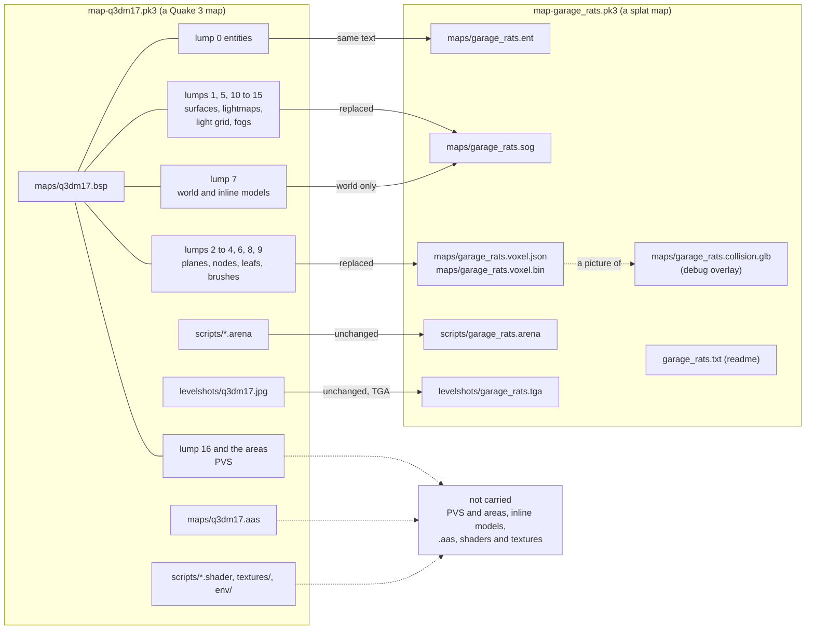
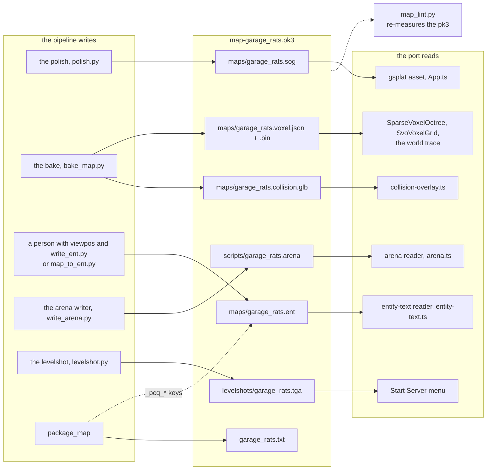
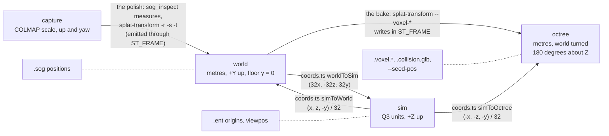
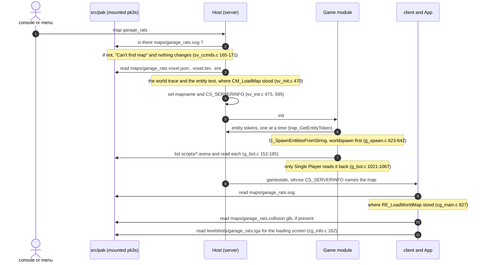

# The splat map format: a Quake 3 map with its BSP swapped out

This is the contract between the pipeline in `splat-maps/`, which writes a splat map, and the
port, which reads one. It is meant to be enough to write the port's reader from it alone.
Citations are ioquake3 at 5883936 (`file:line` under `code/`), NetRadiant-custom's q3map2 at
8216133 (`file:line` under `tools/quake3/q3map2/`), the port's own `src/` by file and symbol, or
the pipeline's own files in `splat-maps/`.

**In one paragraph.** A splat map is a Quake 3 map pk3. It is keyed by a bare map name, the
*stem*, and laid out as Q3 lays out a map. The BSP is gone. The parts that lived inside it become
four files beside each other in `maps/`:
- the splat, for the surfaces and the lighting;
- the voxel octree, in two files, for the collision;
- the entity lump, as the same text in a file of its own.

Everything Q3 already kept outside the BSP keeps its Q3 path: the arena block, the levelshot,
music and sounds. All text is Q3's own syntax, read by Q3's own rules. Every coordinate a person
writes is in Q3 units, Z up.

---

## 1. The map in one picture

What each part of a Q3 map becomes. The lumps are those of `qfiles.h:360–376`.



The same, part by part:

| Q3 part | Where Q3 keeps it | In a splat map | Why |
|---|---|---|---|
| Entity string (lump 0) | inside the BSP | **`maps/<n>.ent`**, the same text | The only game data Q3 keeps inside the BSP. `.ent` is q3map2's name for it |
| Surfaces, lightmaps, light grid, fogs, render tree (lumps 1, 5, 10–15; render side of 3) | inside | **`maps/<n>.sog`** | A splat is its own surface with its lighting baked in. There is no light grid and no fog |
| Collision: planes, nodes, leafs, brushes, sides, leaf brushes (lumps 2–4, 6, 8, 9) | inside | **`maps/<n>.voxel.json` + `.voxel.bin`**, with `.collision.glb` as a picture of them | splat-transform's bake |
| Contents and surface flags (lump 1) | inside | none | The octree is one bit per voxel (§3.3) |
| PVS, clusters, areas (lump 16; areas in lump 4) | inside | none | The port's `area` field defaults to 0 and every entity is visible (`addEntitiesVisibleFromPoint`, `src/server/host.ts`) |
| Inline models `*N` (lump 7) | inside | none; the world alone | A capture cannot move (§3.3) |
| `maps/<n>.aas` | beside | none | Bots are held still: with no `.aas` a bot has no AI, and its commands are empty (`src/sim/bots.ts`). An `.aas` needs a BSP (§12) |
| `scripts/*.arena` | beside | **`scripts/<n>.arena`**, unchanged | §4 |
| `levelshots/<n>.*` | beside | **`levelshots/<n>.tga`**, made as `R_LevelShot` makes it | §5 |
| `scripts/*.shader`, `textures/`, `env/` | beside | none of the map's own | Items, players and effects still use retail's |
| `music/`, `sound/` | beside, named in the entities | the same, if the map brings any | Named by worldspawn `music` and `target_speaker` `noise` |
| readme | beside, never read | **`<n>.txt`** | §2.3 |

---

## 2. The tree

### 2.1 What a pk3 holds

For `garage_rats`, the pk3's root:

```
map-garage_rats.pk3
├── maps/
│   ├── garage_rats.sog              the surfaces: a SOG bundle (itself a zip), stored
│   ├── garage_rats.voxel.json       the collision: the octree's header
│   ├── garage_rats.voxel.bin        the collision: the octree's nodes and leaves
│   ├── garage_rats.collision.glb    the debug overlay's mesh
│   └── garage_rats.ent              the entity lump, as text
├── scripts/
│   └── garage_rats.arena            the arena block
├── levelshots/
│   └── garage_rats.tga              128×128, 24-bit, uncompressed
├── music/…  sound/…                 only if the map names its own
└── garage_rats.txt                  the readme: credits, licence, how it was built
```

Nothing else goes in: no `.map`, no `report.json`, no inspection PNGs, no source `.sog`, and no
`shaderlist.txt` (id's and OpenArena's packaging advice: the [Q3Radiant manual, §2.1][q3radiant],
and OpenArena's [Compiling and packaging][oa-packaging]).

### 2.2 Every file: its writer, its reader, and what happens without it

"If missing" gives Q3's own behaviour for the part the file replaces, which the port's reader
should reproduce, and then what the port does.

| Path | Required | Written by | Read by (port) | If missing |
|---|---|---|---|---|
| `maps/<n>.sog` | **yes** | `splat-maps polish`; renamed into place by `package_map` | PlayCanvas's gsplat asset, through `loadSplat` (`src/game-map.ts`), from the mount: `SogBundleParser` takes `file.contents` (`sog-bundle.js:72–73`) | It fails the `map` command's existence check, as a missing BSP does: `Can't find map`, and the current map keeps running (`sv_ccmds.c:165–171`) |
| `maps/<n>.voxel.json`, `maps/<n>.voxel.bin` | **yes** | the bake (`bake_map.py`) | `readOctree` (`src/formats/splat-map.ts`) → `SparseVoxelOctree.fromBuffers` (`src/sim/voxel-svo.ts`) → `SvoVoxelGrid` (`src/svo-voxel-grid.ts`) → `createVoxelTrace` (`src/sim/voxel-trace.ts`), from the mount | Q3: `ERR_DROP "Couldn't load"` (`cm_load.c:618`). The port stops the load with the same words |
| `maps/<n>.collision.glb` | no | the bake (`bake_map.py`) | `loadCollisionOverlay` (`src/collision-overlay.ts`), from the mount | No Q3 equivalent. The port warns and loads without the overlay |
| `maps/<n>.ent` | **yes** | a person: `viewpos` readings through `write_ent.py`, or an editor's `.map` through `map_to_ent.py`; the `_pcq_*` keys by `package_map` (§7) | `readEntityText` (`src/formats/entity-text.ts`), then the game's spawn loop through an entity-token trap | Q3: `G_Error "SpawnEntities: no entities"` (`g_spawn.c:623–642`). A file without a spawn point fails later, at the first spawn: `Couldn't find a spawn point` (`g_client.c:238–249`) |
| `scripts/<n>.arena` | no | the arena writer (`write_arena.py`) | `readInfoFiles` and `loadArenas` (`src/formats/arena.ts`), over `PakFileSystem.getFileList('scripts', '.arena', …)` (`src/pak/vfs.ts`), for the gametypes and the Start Server menu's map list | Q3: the map is missing from every menu but can still be started by name. Single Player falls back to a fraglimit of 10 (`g_bot.c:1021–1067`) |
| `levelshots/<n>.tga` | no | the levelshot step (`levelshot.py`) | the Start Server menu (`src/view/menu-start-server.ts`). Q3's loading screen shows it too (`cg_info.c:162`); the port's does not | Q3: `menu/art/unknownmap` (`cg_info.c:163–165`) |
| `<n>.txt` | no to the engine; **yes to the lint** | `package_map`, from a template | nothing | No Q3 reader. The lint refuses a package without one, because the source's CC BY licence needs its credit (§2.3) |



Two dependencies are not drawn. The levelshot step reads its viewpoint from the `.ent`'s
`info_player_intermission` (§5). `package_map` also builds the pk3 around every file in it (§8).

### 2.3 Names

- **The stem** is lowercase letters, digits and underscores. Q3 matches paths without regard to
  case, but Unix file systems do not, which is why id's shader manual asks for lowercase. The
  longest path, `maps/<n>.collision.glb`, must fit Q3's `MAX_QPATH` of 64 bytes including its NUL
  (`q_shared.h:246`). The stem is therefore at most **44** characters.
- **Every per-map file is named by the stem**, the arena file included. Q3 lets an arena file take
  any name, but q3map2's packager looks for `scripts/<map>.arena` (`autopk3.cpp:628–653`).
- **The pk3 is `map-<n>.pk3`**, the prefix id's editor manual gives map releases ([Q3Radiant
  manual, §2.1][q3radiant]). A later release adds a tag, `map-<n>_<tag>.pk3`, which
  sorts after it and so wins (§9). The stem is read from the pk3's `maps/<n>.sog`, not its name.
- **The readme is `<n>.txt` at the pk3's root.** No engine reads it. It is named after the map
  rather than `readme.txt`, so that two maps' readmes never shadow each other in the one namespace.
- **All paths in the pk3 are lowercase, with forward slashes.**

---

## 3. The entity text: `maps/<n>.ent`

The file holds exactly what a BSP's lump 0 holds. q3map2's `-exportents` writes this file from a
BSP, and `-onlyents` splices it back into one (`exportents.cpp:49–73`; `bsp.cpp:570–603`,
`:889–890`). It is plain ASCII, and LF or CRLF line endings are both fine, since the tokenizer
treats both as whitespace.

### 3.1 How it is read

These are Q3's rules, and the port's reader should reproduce them.

- **Tokens** come from `COM_Parse` (`q_shared.c:461–570`).
  - Whitespace is any byte up to `' '`.
  - `//` runs to the end of the line and `/* … */` to its close. Both are skipped, so NetRadiant's
    `// entity N`, `// brush N` and `//@$& layerdef` lines are harmless. Its saves have CRLF line
    endings, which are whitespace too.
  - A token that starts with `"` runs to the next `"`. It may contain newlines, and it has no
    escapes.
  - Any other token runs to the next whitespace.
  - A token longer than 1023 bytes is **cut short without a word** (`MAX_TOKEN_CHARS`,
    `q_shared.h:235`).
  - The port's is `comParse` (`src/formats/com-parse.ts`).
- **Blocks.** Each entity is `{`, then key and value tokens in pairs, then `}`
  (`G_ParseSpawnVars`, `g_spawn.c:509–553`). Three things are hard errors: a missing `{`, the end
  of the file inside a block, and a `}` where a value should be.
- **Limits per entity:** 64 pairs (`MAX_SPAWN_VARS`), and 4096 bytes of keys and values including
  their NULs (`MAX_SPAWN_VARS_CHARS`), at `g_local.h:326–327`. Going past either is a hard error.
- **The first block must be `worldspawn`**, or the game fails with `The first entity isn't
  'worldspawn'` (`g_spawn.c:564–570`). A file with no blocks at all gives `no entities`
  (`g_spawn.c:623–642`).
- **Keys ignore case** (`Q_stricmp`, `g_spawn.c:34–39`, `:350`). **Classnames do not** (`strcmp`,
  `g_spawn.c:277–292`).
- **A duplicate key has two winners.** `fields[]` keys take the last occurrence
  (`g_spawn.c:406–408`), while keys read at spawn time take the first (`G_SpawnString`'s scan,
  `g_spawn.c:34–39`). The lint therefore refuses duplicates.
- **Unknown keys are dropped silently** (`g_spawn.c:343–380`), which is how `_pcq_*` and q3map2's
  `_q3map2_*` keys ride along. **An unknown classname** prints `… doesn't have a spawn function`,
  and the entity is freed (`g_spawn.c:293–294`, `:469–472`).
- **Values are not validated.**
  - `atoi` and `atof` turn anything unreadable into 0.
  - A vector is `"%f %f %f"`, and components it does not supply are left as they were
    (`g_spawn.c:63–70`).
  - `angle` writes `(0, v, 0)`, which zeroes pitch and roll. So an `angle` that follows an
    `angles` throws their pitch and roll away (`g_spawn.c:370–375`).
  - `G_NewString` turns `\n` into a newline, and that is the format's only escape
    (`g_spawn.c:305–330`).

### 3.2 What the port consumes

A splat map may carry any point entity Q3 knows. This is the part of that vocabulary that sets up
the world, its spawn spots and its camera, which the port's game reads as Q3's does
(`src/sim/spawn.ts`, `src/sim/game.ts`). Items and team entities spawn as they do in Q3, and are
not repeated here.

| Classname | Keys | Meaning | Q3 |
|---|---|---|---|
| `worldspawn` (block 0) | `message` | The long name, sent as `CS_MESSAGE` and shown on the loading screen | `g_spawn.c:580–581`; `cg_info.c:221` |
| | `music` | Intro and loop tracks, sent as `CS_MUSIC` | `g_spawn.c:577–578` |
| | `gravity` | Sets `g_gravity`, default 800. The port's `SP_worldspawn` sets it too (`src/sim/game.ts`) | `g_spawn.c:585–586` |
| | `enableDust`, `enableBreath` | Set the two cvars of the same names | `g_spawn.c:588–592` |
| | `_pcq_*` | Provenance (§7). Ignored at run time | — |
| `info_player_deathmatch` | `origin`, `angle` (or `angles`) | A spawn spot. The player appears 9 units above `origin`, facing the yaw | `g_client.c:37–48`, `:183–259` |
| | `spawnflags` | Bit 0 marks the spot "initial", the one a local player's first spawn prefers | `g_client.c:308–333` |
| | `nobots`, `nohumans` | Bar bots or humans from the spot | `g_client.c:40–47` |
| | `target` | Fired at every spawn from this spot, e.g. a `target_give` | `g_client.c:1201–1209` |
| `info_player_start` | as above | Renamed to `info_player_deathmatch` at spawn | `g_client.c:53–56` |
| `info_player_intermission` | `origin`, `angles`, `target` | The intermission and spectator camera, whose view origin is `origin` itself. With a `target`, it faces a random entity carrying that `targetname`. Only the first one in the file is used | `g_main.c:963–981`; `cg_view.c:641–646` |
| `target_position`, `info_notnull` | `origin`, `targetname` | A point that persists, and something for a `target` to aim at | `g_target.c:416`; `g_misc.c:49` |
| any | `notsingle`, `notteam`, `notfree`, `notq3a` | Frees the entity in that family of gametypes | `g_spawn.c:410–450` |
| any | `gametype` | Frees the entity unless the running gametype's name is a **substring** of the value. The names are `ffa tournament single team ctf oneflag obelisk harvester` | `g_spawn.c:400–401`, `:452–463` |

**A map needs at least one `info_player_deathmatch`** (or `info_player_start`). Every other spawn
path falls back to one, and with none the game dies at the first spawn (`g_client.c:238–249`).
**This format also requires one `info_player_intermission`**, because the levelshot is taken from
it (§5). Q3 itself only falls back to a spawn spot when it is missing (`g_main.c:969–970`).

### 3.3 What a splat map cannot carry

- **Brush entities.** Twelve classnames bind an inline model through their `model "*N"` key:
  - `func_door`, `func_plat`, `func_button`, `func_train`, `func_static`, `func_rotating`,
    `func_bobbing` and `func_pendulum` (`g_mover.c:978–1610`);
  - `trigger_multiple`, `trigger_push`, `trigger_teleport` and `trigger_hurt`, through
    `InitTrigger` (`g_trigger.c:26–33`).

  A splat map has no model lump. In Q3, a missing or bad model drops the server:
  `SV_SetBrushModel` (`sv_game.c:111–120`) and `CM_InlineModel` (`cm_load.c:703–705`). The lint
  refuses these classnames, and any `model` value that begins with `*`.
- **Contents and surface flags**: water, lava, slime, slick, footstep materials. The octree is one
  bit per voxel, and the trace reports none (`TraceResult`, `src/sim/types.ts`; `CONTENTS`,
  `src/sim/constants.ts`).
- **Fog, sky shaders, the light grid.** The capture shows whatever it captured, and the port lights
  models with fixed values (`ENTITY_AMBIENT`, `ENTITY_DIRECTED`, `src/view/entity-light.ts`).
- **`misc_model` and `light`.** Q3 frees both at run time, since the compiler has already used them
  (`g_misc.c:65`, `:141–154`). They do nothing in a splat map. The lint warns about them.

### 3.4 Placing entities with `viewpos`

The port has Q3's `viewpos` (`cg_consolecmds.c:80–84`, registered at `:460`;
`src/view/viewpos.ts`). It prints the view origin and yaw as whole numbers, `(x y z) : yaw`.
Three rules turn a reading into a key:

- **A spawn spot: stand where it goes and subtract 26 from z.**
  - Standing still and not crouched, the view is 26 units above the player's origin
    (`DEFAULT_VIEWHEIGHT`, `bg_public.h:52`; `bg_pmove.c:1307`).
  - The origin is 24 units above the floor (the player's mins are −24, `g_client.c:27`).
  - So `z − 26` is the height at which the spot's editor box, `(-16 -16 -24) (16 16 32)`
    (`g_client.c:30`), rests on the floor. The printed yaw is the `angle`.
  - At spawn, the player appears 9 units higher and drops onto the floor (`g_client.c:183–259`).
    A 9-unit fall lands without a sound (L21).
- **The intermission point: take the reading as it is.** At intermission the view origin *is* the
  entity's origin (`cg_view.c:641–646`), and the field of view is fixed at 90°
  (`cg_view.c:480–482`). So frame it with `cg_fov 90`. `viewpos` prints no pitch, so aim the
  camera with a `target` at a `target_position`, placed from a second reading of the spot to look
  at. The game computes the angles from the two points (`g_main.c:974–981`).
- **Other point entities** take the reading as it is.

`write_ent.py` applies these rules to readings pasted as `viewpos` prints them. It notes each
reading above its entity, and checks the spots in the bake as L20–L22 do.

### 3.5 Worked example

`garage_rats`, as the `.ent` packed in its pk3 on
[its release](https://github.com/Loppas/playcanvas-quake3/releases/tag/splat-maps-v0.1.0) has it,
less its other eight spawn spots, entities 2 to 9.
- Entity 1 is the first spawn spot, from the `viewpos` reading `(-4 -4 69) : 0`, less 26 in z
  (§3.4).
- Entities 10 and 11 are the intermission point and what it faces, each a reading taken as it is.
- The `_pcq_*` keys are the ones `package` wrote (§7): the polish's and the bake's records, from
  the garage aligned at life size, as `splat-maps/examples/` rebuilds it, and the commit that
  built the map.

```
// entity 0
{
"classname" "worldspawn"
"message" "The Garage"
"_pcq_format" "1"
"_pcq_source" "Garage - High Detail Test by Ethan, https://superspl.at/scene/8f4d8e05"
"_pcq_license" "CC-BY-4.0"
"_pcq_polish" "--metric-height 3.0 --player-height 0.1"
"_pcq_scale" "17.49962417"
"_pcq_bake" "--voxel-size 0.25 --voxel-external-fill 0.875 --voxel-carve 0.75,0.125 --seed-pos 0.125,-1.5,0.125 --collision-mesh smooth"
"_pcq_splat_transform" "3.1.6"
"_pcq_pipeline" "16cf643"
}
// entity 1
{
"classname" "info_player_deathmatch"
"origin" "-4 -4 43"
"angle" "0"
"spawnflags" "1"
}
// entity 10
{
"classname" "info_player_intermission"
"origin" "1056 2016 868"
"target" "intermission_view"
}
// entity 11
{
"classname" "target_position"
"targetname" "intermission_view"
"origin" "0 0 100"
}
```

---

## 4. The arena block: `scripts/<n>.arena`

The arena block is Q3's own file, unchanged. It is how menus list a map without loading it.

- **Syntax.** `{`, then key/value pairs, then `}`, read with the same `COM_Parse` as §3.1
  (`G_ParseInfos`, `g_bot.c:68–110`).
  - The value is read without crossing a line break (`COM_ParseExt(&buf, qfalse)`, `g_bot.c:103`),
    so **a key and its value share a line**. A value missing from the line becomes `<NULL>`.
  - Retail leaves keys unquoted and quotes values.
- **Each block becomes an info string.** `Info_SetValueForKey` refuses any key or value containing
  `\`, `;` or `"` (`q_shared.c:1330–1345`). A block holds at most 1024 bytes (`MAX_INFO_STRING`), a
  file at most 8192 bytes, and all the arenas loaded together at most 1024 blocks
  (`bg_public.h:715–716`).
- **Where it is read:**
  - The game reads `g_arenasFile` or `scripts/arenas.txt`, then every `scripts/*.arena` in the
    filesystem's order (`g_bot.c:152–185`). The menus do the same (`ui_gameinfo.c:168–205`).
  - The server never checks it. Any map runs in any gametype (`sv_ccmds.c:165–171`).

| Key | Required here | Meaning | Read by |
|---|---|---|---|
| `map` | **yes**, equal to the stem | The join between the arena and the map | `ui_startserver.c:176`; `g_bot.c:197` |
| `longname` | **yes** | The display name. Keep it equal to worldspawn's `message` | `ui_splevel.c:652` |
| `type` | **yes** | Space-separated gametypes. `GametypeBits` knows five, `ffa tourney single team ctf`, and ignores the rest (`ui_startserver.c:113–151`). The port's Start Server knows a sixth, `clanarena`, for Clan Arena. Note `tourney` here against `tournament` in §3.2's `gametype` key | `ui_startserver.c:268` |
| `fraglimit`, `timelimit` | no | Single Player only | `g_bot.c:1029–1044` |
| `bots` | no | Bot names: Single Player's opponents, and the bots Server Options seeds a skirmish with, from its second slot (`ui_startserver.c:1076–1110`). The port's Server Options seeds them too | `g_bot.c:1059` |
| `special` | no | `Training` or `Final`, for Single Player tiers | `g_bot.c:1053–1056` |

Mods add keys and `type` tokens rather than new files. The lint warns about tokens outside the
five, and does not refuse them. The example:

```
{
map "garage_rats"
longname "The Garage"
type "ffa tourney team"
}
```

---

## 5. The levelshot: `levelshots/<n>.tga`

The pipeline makes the picture Q3's `levelshot` command would make, from the same point and in
the same form.
- **Q3's command.** `Cmd_LevelShot_f` puts the player at the intermission point
  (`BeginIntermission()`, `g_cmds.c:420–442`). The client then runs `screenshot levelshot` four
  frames later (`cl_cgame.c:346–356`), and that calls `R_LevelShot` (`tr_init.c:566–625`).
- **The view.**
  - The camera stands at `info_player_intermission`'s origin, with no view height added.
  - It faces the entity's `angles`, or its `target` (`cg_view.c:641–646`; `g_main.c:963–981`).
  - The horizontal field of view is 90° (`cg_view.c:480–482`).
  - The frame is 4:3, so the vertical field of view is 2·atan(0.75) ≈ 73.74°.
- **The sampling.** `R_LevelShot` treats the screen as a 512 × 384 grid and averages each 4 × 3
  block into one pixel (`tr_init.c:597–616`). So the pipeline renders **512 × 384**, then averages
  each 4 × 3 block. The 4:3 frame is squashed to 1:1, as retail's are.
- **The file:**
  - an 18-byte TGA header: image type 2 (uncompressed true colour), width and height 128, 24 bits
    per pixel, descriptor 0, all other bytes 0 (`tr_init.c:589–594`);
  - then 128 × 128 pixels in **BGR** order, **bottom row first** (`tr_init.c:611–614`), as
    `glReadPixels` returns them;
  - 49,170 bytes in all.
- **No gamma table.** `R_LevelShot` applies the display's gamma ramp only when the hardware owns
  gamma (`tr_init.c:618–621`). The rasterizer's image is already what a screen shows.
- **The near plane** is Q3's `r_znear`, 4 units (`tr_init.c:1074`).
- **The rasterizer's camera is in the octree's frame** (§6's table). It was measured before any
  picture was trusted: `sog_inspect --render` had been handing it file coordinates, and every
  check view looked the wrong way, upside down.

Retail ships levelshots as uppercase JPEGs (`levelshots/Q3DM17.jpg`). Q3's lookup finds either,
because it ignores case and falls back through the image extensions (`files.c:1128–1154`;
`tr_image.c:922–931`). This format writes what the command writes.

---

## 6. The frames

Four frames are in play. Each file is in exactly one of them.

| Frame | Units, up | Defined at | Files in it |
|---|---|---|---|
| **capture** | arbitrary: COLMAP's scale, up and yaw, which gsplat's trainer turns +Z roughly up | the SfM solve | the trained PLY, and `export`'s raw `.sog` |
| **world** | metres, +Y up, floor at y = 0, the plan's centre at the origin | the polish (`sog_inspect.py:706–707`); `simToWorld`, `src/coords.ts` | `maps/<n>.sog` |
| **sim** | Q3 units (32 to the metre), +Z up; X forward, Y left | `UNITS_PER_METRE`, `src/coords.ts` | `maps/<n>.ent` (every `origin`, `angle`, `angles`); `viewpos`'s readout |
| **octree** | metres; the world turned 180° about Z, `ST_FRAME = diag(-1,-1,1)` | `simToOctree`, `src/coords.ts`; `conventions.md` ("Current answer") | `maps/<n>.voxel.json` and `.bin`; `maps/<n>.collision.glb`; the bake's `--seed-pos` |



Where each conversion happens:

| Conversion | Where | Notes |
|---|---|---|
| capture → world | `splat-maps polish`, once, baked into the splat positions | So a map carries no orientation of its own, and the port adds none (`src/formats/splat-map.ts`) |
| world → octree | the bake, inside splat-transform | Calibrated for v3.1.6 only. Re-run `calibrate_transform.py` after an upgrade |
| sim ↔ world | the port only, `simToWorld` and `worldToSim` (`src/coords.ts`) | The pipeline writes no sim coordinates except the ones people write into the `.ent` |
| sim → octree cell | the port, `SvoVoxelGrid.isSolid` (`src/svo-voxel-grid.ts`), exact integer arithmetic | It relies on `voxelResolution × 32` being the voxel's size in units, and on `gridBounds.min` lying on a whole cell. The second is asserted in `SvoVoxelGrid`'s constructor |
| octree → world, for the overlay | the port, a 180° turn about Z (`loadCollisionOverlay`, `src/collision-overlay.ts`) | |
| octree → the editor's reference model | `glb_to_editor.py`: `(-32x, -32y, 32z)`, the world frame in units, +Y up | NetRadiant-custom and its q3map2 turn every model from Y up to Z up, `(x, -z, y)`, with no scale (q3map2's `model.cpp:325–329`; the editor's `plugins/assmodel/model.cpp:678–682`). That turn is `worldToSim` without the 32, so a `misc_model` at the origin sits where the player meets the mesh. The bundled q3map2 put the garage's 667,572 triangles exactly on it |
| sim → octree, for spawn checks | the lint, using `simToOctree`'s formula | |
| sim → the rasterizer's camera | the levelshot step, through `sim_to_octree` | The rasterizer takes its camera in splat-transform's frame, the octree's, not the file's. Measured on 3.1.6 with coloured probe splats: aimed at +X it sees the file's −X, the file's +Y comes out down, right is forward × up, and `--camera-fov` is vertical |

A worked point: the spawn at sim `(-4, -4, 43)` is world `(-0.125, 1.344, 0.125)` m and octree
`(0.125, -1.344, 0.125)` m. The bake's seed `0,-5,0`, in the octree frame, is world `(0, 5, 0)` m
and sim `(0, 0, 160)`.

**Scale is a property of the file, never of the port.** The port always has 32 units to the metre
and the 56-unit player (`UNITS_PER_METRE`, `src/coords.ts`; `g_client.c:27–28`). A "rats" map
is a splat magnified by the polish, and `_pcq_scale` records by how much (§7).

### 6.1 Sizing the bake in Quake units

The bake runs on the delivered file, after the polish has scaled it. Delivered metres are always
32 units, so the bake's sizes are chosen in Quake units, and the limits on them are the same for
every map, whatever its size or magnification. splat-transform takes them in metres, as units ÷ 32.

**There is no set voxel size.** One is chosen per map, starting at 8 units (`bake_map.py`'s
default), and recorded in `_pcq_bake`. The choice sits inside these limits:
- **It is a whole number of units**, so every size derived from it, in metres, is exact in binary.
- **It is at most 13 units**, for two reasons:
  - A one-voxel rise has to be a step. Q3 steps up at most 18 units (`STEPSIZE`, `bg_local.h:27`).
    Smaller voxels make smaller steps: a 4-unit rise raises `EV_STEP_4`, and a rise of 2 units or
    less raises no step event at all (`bg_slidemove.c:319–329`).
  - The carve's box is at least three voxels tall (below), and it must fit under 40 units.
- **The capture sets a useful floor.** Voxels much finer than the capture's detail at its
  delivered scale only voxelise splat scatter. The garage's ~2.8 cm splat spacing is ~14 units at
  16× (`conventions.md`, "Capture resolution"). Each halving of the voxel also does about 8×
  the work, both in the bake's dense grid and in the cells each trace tests.
- **The grid's size sets a ceiling on cost.** A large map may need a coarser voxel to fit the
  bake on the GPU at all.

**The carve's box is never larger than the crouched player, 30 × 40 units** (`bg_public.h:50–53`:
mins −24; maxs 16 crouched, 32 standing). That way the carve never seals a space Q3's player could
crouch through.
- **What the carve does.** It fills every space a player-sized box cannot reach from the seed.
- **How its box is built.** It is not a capsule. It is a box centred on one cell, grown by
  separable dilation (`carve` and `gpuDilate3` in splat-transform 3.1.6's `cli.mjs`).
  `--voxel-carve h,r` becomes:
  - `2⌈r/v⌉ + 1` voxels wide and deep;
  - `2⌈h/2v⌉ + 1` voxels tall.

  Box dimensions are therefore odd multiples of the voxel, and no voxel size gives 30 × 40
  exactly. A box smaller than the player is the safe direction. It leaves open some pockets the
  player cannot enter, which the trace still stops the player at, but it never seals a gap the
  player fits through.
- **Deriving the flags.** The bake derives them from the voxel `v`, in units:
  - `k = ⌊(30/v − 1)/2⌋` and `j = ⌊(40/v − 1)/2⌋`;
  - `r = (k − ½)·v`, or 0 when k is 0, and `h = (2j − 1)·v`, both converted to metres.

  Each value sits half a voxel inside its rounding boundary, so floating point cannot tip it.

| Voxel | `--voxel-size` | `--voxel-carve h,r` | Carve box, in units |
|---|---|---|---|
| 8 units | 0.25 | 0.75,0.125 | 24 × 40 |
| 4 units | 0.125 | 0.875,0.3125 | 28 × 36 |
| 2 units | 0.0625 | 1.0625,0.40625 | 30 × 38 |
| 8 units, as shipped | 0.25 | 1.75,0.47 | **40 × 72**: seals gaps under 40 wide or 72 tall that the player fits through |

At 8 units the carve box is exactly the crouched player's height, which is one reason 8 is the
starting point.

**The external fill is the smallest reach that seals the hull.** `--voxel-external-fill d`
works in three steps (`fillExterior`, cli.mjs):
1. It grows the solid voxels by ⌈d/v⌉ in every direction.
2. It floods the grown grid from its boundary.
3. It grows what the flood reached by the same amount and makes it solid.

The consequences:
- **A narrow hole stops the flood.** A hole in the hull narrower than 2⌈d/v⌉ voxels stops it,
  so the fill never enters the room.
- **A wider hole leaks.** The flood reaches the seed. splat-transform then logs
  `seed reachable from outside, skipping exterior fill`, as information only, and writes the
  octree with the whole outside open. The bake refuses a leak, as q3map2 refuses a map that
  leaks.
- **Too large a reach also seals the ring of reconstruction spill around the room.** The voids
  between the room and the spill then count as inside, and the fill leaves them open.

The last point matters because the carve box sized here is small:
- **The shipped box sealed the capture's holes.** The 40 × 72 box could not get through them,
  so the voids behind them were sealed.
- **The box sized here gets through them.** A 24 × 40 box gets through any hole 24 units wide,
  and the player through one 32 units wide.
- **With the shipped reach, the player can get under the floor.** Baked with 7 voxels at 8
  units, the garage lets the crouched player's box reach 185,000 positions under its floor.
- **With the smallest reach that seals, it can hardly get there.** 4 voxels leaves 2,855
  positions, fewer than the shipped bake's 8,313, in five small pits by the walls (L24).

The bake therefore finds the reach by baking. It bisects over whole voxels for the smallest reach
that does not leak, from 1 voxel up to the standing player's 56 units. Leaking only stops as the
reach grows, so the search takes a few bakes.

**The garage, measured** (`garage_rats`, by `bake_map.py`, on the shipped `.sog`):

| | Shipped | 8 units | 4 units |
|---|---|---|---|
| `--voxel-carve`, and its box | `1.75,0.47`, 40 × 72 | `0.75,0.125`, 24 × 40 | `0.875,0.3125`, 28 × 36 |
| External fill | 7 voxels, the default | 4 voxels (32 units); 3 leaks | 7 voxels (28 units); 6 leaks |
| Box positions under the floor (feet below −48) | 8,313, down to −192 | 2,855, down to −224 | 4,681, down to −104 |
| Level moves of the player's box across the floor | 94.0% | 93.0% | 93.7% |
| Step-ups per 100 units walked | 0.35, `EV_STEP_8` | 0.40, `EV_STEP_8` | 0.75, `EV_STEP_4` |
| Units climbed per 100 walked | 2.9 | 3.4 | 3.4 |
| Bake; the fill search in all | about 25 s | 27 s; 112 s | 50 s; 301 s |
| `.voxel.bin`, `.collision.glb` | 1.1 MB, 6.7 MB | 1.2 MB, 12.0 MB | 5.0 MB, 30.7 MB |
| Voxels a standing player's box overlaps, at most | 200 | 200 | 1,215 |

- **How the floor is measured.** The player's box rests on the highest voxel under its 30-unit
  footprint. A rise of 2 units or less raises no step event. A larger one, up to 18, is a step
  the view smooths over 200 ms (`bg_slidemove.c:319–329`; `cg_view.c:299–306`).
- **Peak memory** was about 2.9 GB of CPU and 0.87 GB of GPU for all three bakes.
- **Reach behind the walls.** At 8 units the box also reaches pockets up to 224 units behind the
  −x wall. All of them are at least 136 units up, three times a jump's height: `JUMP_VELOCITY`
  270 at gravity 800 rises 46 units (`bg_local.h:29`).

**The garage keeps 8 units.** 4 units buys nothing measurable. The floor is as level, and the
player climbs the same 3.4 units per 100 walked, only in twice as many steps of half the size.
It costs:
- 1.9× the bake time;
- 4× the octree;
- 2.6× the debug mesh;
- 6× the voxels each trace tests.

---

## 7. Provenance: the `_pcq_*` keys

Worldspawn in the `.ent` records how the map was made. q3map2 records its own command line and
version in worldspawn the same way (`_q3map2_cmdline`, `_q3map2_version`;
`bspfile_abstract.cpp:426–441`). No run-time code reads these keys (§3.1).

| Key | Holds | Written from | `garage_rats` |
|---|---|---|---|
| `_pcq_format` | This layout's version, an integer | `package_map` | `1` |
| `_pcq_source` | The source capture: title, creator, link | the source's `license.txt`, or `splat-maps polish --license` for a capture with none, through the polish record `<n>.polish.json` | `Garage - High Detail Test by Ethan, https://superspl.at/scene/8f4d8e05` |
| `_pcq_license` | The source's licence, as an SPDX identifier | as above | `CC-BY-4.0` |
| `_pcq_polish` | `sog_inspect`'s arguments: metric height, player height, up hint | the polish record | `--metric-height 3.0 --player-height 0.1` |
| `_pcq_scale` | Metres of the finished map per unit of the polish's input: the `-s` factor, metric correction included | the polish record, from the `-s` it applied | `17.49962417` |
| `_pcq_bake` | The bake's splat-transform flags, sized as §6.1 sizes them, with the seed in the octree frame | the bake record `<n>.bake.json` | `--voxel-size 0.25 --voxel-external-fill 0.875 --voxel-carve 0.75,0.125 --seed-pos 0.125,-1.5,0.125 --collision-mesh smooth` |
| `_pcq_splat_transform` | The splat-transform version the polish and the bake ran | both records; the lint refuses a mismatch | `3.1.6` |
| `_pcq_pipeline` | The commit of this repository, playcanvas-quake3, that built the map | `package_map` | `16cf643` |

The rules:
- **The pipeline owns these keys.** A hand-written `.ent` leaves them out. `package_map` writes them
  into worldspawn when it builds the pk3, replacing any it finds, as q3map2 writes its own at
  compile time.
- **No absolute paths** in any value. `report.json`'s `input` is one, and it stays out.
- **They stay within §3.1's limits.** Worldspawn's pairs are counted against the 64 pairs and 4096
  bytes, and each value is at most 1023 bytes.

**The readme** carries the same facts for people, in the sections of OpenArena's template
([Readme model][oa-readme]):
- title, map name, pk3 name and author;
- gametypes;
- botplay: none, since there is no `.aas`;
- how it was built: capture, pipeline commit, splat-transform version, polish and bake arguments;
- credits;
- licence.

The credits give the attribution CC BY 4.0 asks for: the creator, the title, the source
link, the licence and its link, and a statement that the capture was modified (polished,
rescaled and cleaned).

---

## 8. Packaging

- **A pk3 is a plain zip.**
  - No zip64 records, which the port's reader refuses (`ZipArchive.open`, `src/pak/zip.ts`). So
    the pk3 stays under 4 GiB and 65,535 entries.
  - No duplicate entry names. Within one archive the later copy would win (`parseDirectory`,
    `src/pak/zip.ts`), and the lint refuses them.
  - Directory entries are optional, since the reader skips them.
- **The `.sog` is stored (method 0)**, not deflated. It is a zip of WebP images already. Storing
  it avoids inflating about 176 MB, and the entry can be handed whole to `SogBundleParser`.
- **Everything else may be stored or deflated (method 8)**, which the port inflates with `fflate`
  (`ZipArchive.readEntry` and `inflateEntry`, `src/pak/zip.ts`). No other method is allowed.
- **Every entry carries the date 1980-01-01**, the zip format's earliest. No reader looks at it,
  and a fixed date means the same inputs always make the same pk3, byte for byte.
- **Where it goes.** The port mounts `public/maps/*.pk3` as the lowest layer of its search path,
  with the player's `baseq3/*.pk3` above, later over earlier (`mountMapPaks`, `src/pak/boot.ts`;
  `searchPath`, `src/pak/vfs.ts`). A map can therefore be installed Q3's way, by dropping its pk3
  into `baseq3`, and a later pk3 can patch it. Delivery (`deliver_map.py`) writes to `public/maps/`.

---

## 9. Versioning

Four things carry a version:
- **The layout: `_pcq_format`** in worldspawn.
  - It changes only when this spec changes what a reader must do.
  - The port ignores it, as Q3 ignores `_` keys. The lint enforces it.
  - A later BSP-backed layer (§12) needs no bump to be told apart, because it is recognised by
    `maps/<n>.bsp`.
- **Each file's own format:**
  - the SOG's `meta.json` `version` (2);
  - the octree header's `version` (`"1.1"`, whose `leafSize` is always 4,
    `VoxelOctreeHeader.leafSize` in `src/sim/voxel-svo.ts`);
  - both files' `asset.generator`.

  Their formats own them, not this spec. The lint checks the SOG's `version` (L6) and both
  generators against `_pcq_splat_transform` (L19).
- **A release: the pk3's name.**
  - A fixed release takes a name that sorts later, such as `map-<n>_v2.pk3`, and never reuses a
    name (OpenArena's [Compiling and packaging][oa-packaging]). The port's order is
    `FS_PathCmp`'s (`pakOrder` and `fsPathCmp`, `src/pak/mount.ts`).
  - A released pk3 is never rewritten in place.
- **The build: `_pcq_pipeline`**, the commit that made it.

---

## 10. The lint: `map_lint.py`

The lint re-measures a finished pk3 and makes no changes to it. **E** refuses the package, and
**W** reports and passes it. Here "the octree" means the package's own `.voxel.*`, decoded as the
port's reader lays out its words (`src/sim/voxel-svo.ts`).

| # | Rule | Level |
|---|---|---|
| **Container** | | |
| L1 | A plain zip with no zip64 records, no duplicate names, and only methods 0 and 8 | E |
| L2 | `maps/<n>.sog` stored | E |
| L3 | Every path lowercase, with forward slashes. Nothing outside §2.1's tree | E / W |
| **Names** | | |
| L4 | The stem is the one `maps/<n>.sog`'s, and matches `[a-z0-9_]{1,44}`. The pk3 is `map-<n>.pk3`, or `map-<n>_<tag>.pk3` for a later release (§9). Every per-map file uses the stem | E |
| L5 | The required files are present: `.sog`, `.voxel.json`, `.voxel.bin`, `.ent`, `<n>.txt` | E |
| **The splat and the octree** | | |
| L6 | The `.sog` opens as a zip, its `meta.json` has `version` 2, and `count` > 0 | E |
| L7 | The octree passes `fromBuffers`'s checks: the `.bin` is `(nodeCount + leafDataCount) × 4` bytes, and `leafDataCount = 2 × numMixedLeaves` (`SparseVoxelOctree.fromBuffers`, `src/sim/voxel-svo.ts`). `leafSize` is 4 | E |
| L8 | `gridBounds.min` lies on a whole cell, which `SvoVoxelGrid`'s constructor asserts (`src/svo-voxel-grid.ts`) | E |
| L9 | `voxelResolution × 32` is a whole number of units, at most 13 (§6.1) | E |
| L10 | The carve box that `_pcq_bake`'s `--voxel-carve` rounds to, `(2⌈r/v⌉+1)·v` wide and `(2⌈h/2v⌉+1)·v` tall, is at most 30 × 40 units (§6.1) | E |
| **The entity text** | | |
| L11 | It parses under §3.1: block 0 is `worldspawn`, at most 64 pairs and 4096 bytes per block, no value over 1023 bytes, no duplicate keys in a block | E |
| L12 | It is printable ASCII, and no value contains `"` | E |
| L13 | No brush classname from §3.3, and no `model` value beginning with `*` | E |
| L14 | At least one `info_player_deathmatch` or `info_player_start` survives the gametype keys in every gametype the arena lists | E |
| L15 | Exactly one `info_player_intermission` | E |
| L16 | Every `target` names a `targetname` that exists | E |
| L17 | Classnames are exact matches for Q3's spawn table or item list (`g_spawn.c:184–258`; `bg_misc.c`) | W |
| L18 | `misc_model` and `light` are present | W |
| L19 | Every `_pcq_*` key of §7 is present, `_pcq_format` is known, no value holds an absolute path, and `_pcq_splat_transform` matches both records | E |
| **Placement** | | |
| L20 | For every spawn spot, the player box `(-15 -15 -24)–(15 15 32)` (`g_client.c:27–28`), raised 9 units above the origin, touches no solid voxel. So it is inside `gridBounds`, since everything outside it is solid | E |
| L21 | For every spawn spot, the drop `h` from the spawned box's feet (origin z − 15) to the first solid below, at the map's gravity `g` (worldspawn `gravity`, default 800). Q3 grades a landing by `0.0002·g·h` (`bg_pmove.c:954–955`). **W** when that is over 7, which makes a landing thud and view dip (`bg_pmove.c:991–992`; `cg_event.c:589–594`): a drop over 43 units at 800. **E** when it is over 40, a landing that hurts (`g_active.c:556–567`): a drop over 250 units at 800 | E / W |
| L22 | The intermission origin is in free space | E |
| L23 | No two spawn spots' boxes overlap, since a player standing on one would block the other (`SpotWouldTelefrag`, `g_client.c:81–101`) | W |
| L24 | The crouched player's box, `30 × 30 × 40`, flooded from the first spawn spot through every position where it fits on the voxel lattice, reaches no position with its feet more than 48 units under the floor (z = 0). One that does has found a hole in the capture it could fall through (§6.1) | W |
| **Arena, levelshot, readme** | | |
| L25 | `scripts/<n>.arena` parses as §4, has exactly one block, and that block's `map` is the stem, with `longname` and `type` set | E, if the file is present |
| L26 | `type` tokens are outside `ffa tourney single team ctf clanarena` | W |
| L27 | `longname` differs from worldspawn's `message` | W |
| L28 | The levelshot matches §5 byte for byte in its header and is 49,170 bytes | E, if the file is present |
| L29 | The readme names the source, its creator, its licence and the licence's link | E |

---

## 11. The load sequence

From `map <n>` to each file and each reader. This is Q3's order. Where the port puts each step is
noted after the diagram.



On a listen server the client's collision map is the server's, cached (`cm_load.c:590–593`). The
port's client builds its own instead, as the host does: `createVoxelTrace` over the same octree,
for the client's `PlayerView` (`GameMap`, `src/game-map.ts`) and for the host
(`hostMapFromData`, `src/server/host-map.ts`).

**Where the port puts each step:**
- **The `.ent` and the `.arena`** are read through the mount (`src/formats/entity-text.ts`,
  `src/formats/arena.ts`).
- **The rest** is read through it too (`src/formats/splat-map.ts`; `loadMap` in `src/App.ts`),
  and the map has a lifetime. For `map <n>`, the host checks for the `.sog`, and the program
  frees the old map and reads the new one before the host spawns it. The port reads a map's
  files asynchronously, so the host runs no frame until they are in. The first map comes from
  `?map=<n>` (`src/main.ts`).
- **The Start Server menu** lists the maps by their arenas (`src/view/menu-start-server.ts`).

---

## 12. What this format leaves for later

- **A real BSP.** q3map2 could compile `maps/<n>.bsp` from a `.map` made of three parts:
  - the `.ent`'s entities;
  - a caulk hull, to seal the map;
  - the collision mesh as an autoclipped `misc_model`.

  That BSP would let stock ioquake3 load the map's entities, and bspc build an `.aas`, which is the
  only route to bots. It layers onto this format without changing it: the `.ent` is that `.map`
  without the brushes, and `-onlyents` can splice it into any BSP (`bsp.cpp:570–603`,
  `:889–890`; autoclip, `model.cpp:357–372`).
- **Materials.** A layer beside the octree that carries contents and surface flags: water,
  footsteps, slick.
- **Brushless triggers.** Box triggers, in place of the brush models §3.3 refuses.
- **Lighting for models**: a light grid, or `q3map_sun`'s equivalent, per map.

---

## 13. Choices this spec makes

Filling in the format's detail took these choices.

1. **The pk3 is `map-<n>.pk3`**, id's prefix for map releases (§2.3).
2. **The stem is `[a-z0-9_]`, at most 44 characters**, from `MAX_QPATH` (§2.3).
3. **The readme is `<n>.txt` at the root**, and the lint requires it (§2.3, §10 L29).
4. **The `_pcq_*` keys.** Three go beyond the source, its licence, the polish and bake arguments
   and the splat-transform version: `_pcq_format`, `_pcq_scale` and `_pcq_pipeline`.
   `package_map` writes all the keys, and a hand-written `.ent` leaves them out (§7).
5. **One `info_player_intermission` is required**, for the levelshot (§3.2, L15).
6. **Brush classnames and `*N` models are refused** (§3.3, L13).
7. **The levelshot carries no gamma table**, and it is rendered at 512 × 384 and averaged as 4 × 3
   blocks (§5).
8. **The lint's thresholds.**
   - *The bake's sizes* (§6.1): a whole-unit voxel of at most 13 units (L9), and a carve box of at
     most the crouched player's 30 × 40 (L10).
   - *Spawn drops*: a spawn's drop is judged by Q3's own landing. It is a warning when the
     landing would thud, and an error when it would hurt (L21).

[q3radiant]: https://icculus.org/gtkradiant/documentation/q3radiant_manual/ch02/pg2_1.htm
[oa-packaging]: https://openarena.fandom.com/wiki/Mapping_manual/Compiling_and_packaging
[oa-readme]: https://openarena.fandom.com/wiki/Readme_model
