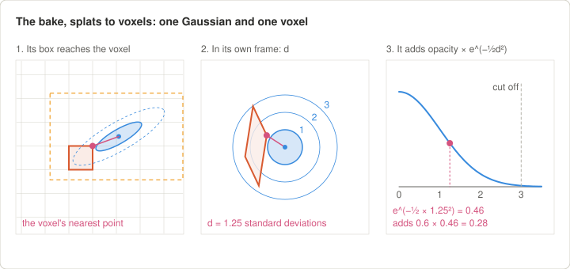
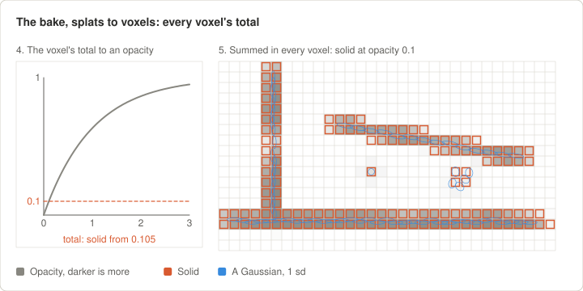
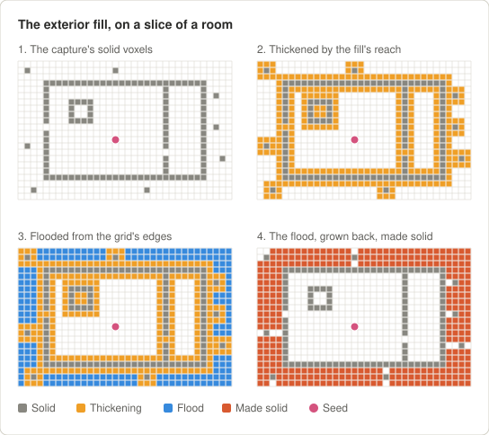
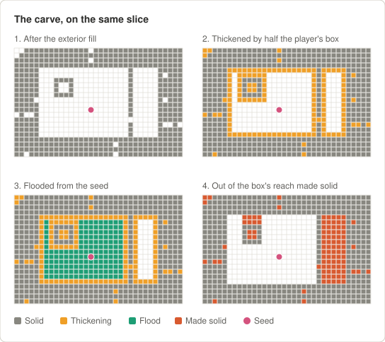

# Maps — A polished capture to a playable Quake 3 map

This turns a trained splat into `map-<stem>.pk3`, a Quake 3 map the port loads: the splat for its
surfaces, a voxel octree for its collision, and Q3's own entity text, arena block and levelshot
beside them (`map-format.md` §2.1). Every step writes its output, reads it back and measures it,
and stops on an error. So a step that finishes without an `ERROR` line has been checked. Read its
`WARNING` lines before moving on.

From a video, `splat-maps all` runs the training and then every step here, with starter entities
for step 4: one spawn over the floor and the intermission above it ([training.md](training.md),
"Quick start"). Its map is the first draft of these steps, whose entities steps 4 to 9 replace.

```
<project>.sog ─polish─▶ <stem>.sog ─bake, from a seed─▶ .voxel.*  .collision.glb
                                                                  │
                          place the entities: the editor, or viewpos
                                                                  │
<stem>.ent ─bake again, from the spawn─▶ levelshot ─▶ arena ─▶ package ─▶ deliver
```

**Units.** Every position a person types here is in Q3 units, as `viewpos` prints them:
X forward, Y left, Z up, 32 units to the delivered metre, the floor at z = 0 and the plan's centre
at the origin (`map-format.md` §6). A "rats" map is magnified by the polish, so its metres are
already the game's.

**Shells.** A command given once runs the same in Windows' command prompt and in bash: its
paths' forward slashes work in both. Where the shells differ, each has a block of its own,
headed by the systems and the shell it is for.

---

## Once per machine

| Tool | What for |
|---|---|
| The environment, from [training.md](training.md#the-environment) | the `gsplat` env, with this package's `splat-maps` command in it. Activate it once per shell: `conda activate gsplat` |
| **Node**, as the port requires it ([Requirements](../../README.md#requirements)) | splat-transform |
| **splat-transform 3.1.6** | The polish, the bake and the levelshot install it with npm if it is missing, and refuse any other version, since the frames and the bake were calibrated on 3.1.6 ([conventions.md](conventions.md), "Current answer") |
| **The port**, the checkout `splat-maps\` sits in | delivery writes to its `public\maps\`. `--port DIR` names another checkout |
| **NetRadiant-custom 20260114**, only for the editor route | unzipped into `editor\netradiant-custom-20260114\`, which git ignores. It bundles q3map2. On Linux, the release's AppImage, in the same folder, untried; there is no build for macOS |

**The editor's engine path.** Point it at a folder of its own, never at the game install. The
editor offers to install its files there, and may write `scripts\shaderlist.txt`
([conventions.md](conventions.md), "The map editor and q3map2"). This runbook uses
`data\editor\`, with two folders made inside it before the first run:

**Windows (cmd)**

```bat
mkdir data\editor\baseq3\models\splatmaps
mkdir data\editor\baseq3\maps
```

**Linux/macOS (bash)**

```bash
mkdir -p data/editor/baseq3/models/splatmaps
mkdir -p data/editor/baseq3/maps
```

---

## Per map

Run every command from `splat-maps\`. The working folder is `data\<project>\map\`. Every step
writes beside the `.sog` it is given, so this one folder ends up holding every part `package_map`
reads.

### 0. Name the map

The **stem** is the map's name everywhere: lowercase letters, digits and underscores, at most 44
characters (`map-format.md` §2.3). Every file is named by it. The garage's is `garage_rats`.
Keep it to **15**: Start Server shows 15 characters of a map's name, and finds no levelshot for a
longer one. `all` and the lint warn of a longer stem.

### 1. Check the source carries its licence

The polish reads the credit for the capture from a `license.txt` inside the input `.sog`, and the
package refuses a map without one (L29). A `.sog` downloaded from superspl.at has one:

```
Title: Garage - High Detail Test
Author: Ethan (https://superspl.at/user?id=ethan3111)
Source: https://superspl.at/scene/8f4d8e05
License: CC Attribution (Creative Commons Attribution)
License URL: http://creativecommons.org/licenses/by/4.0/
Requirements: Author must be credited. Commercial use is allowed.
```

**A capture of your own has none**, since `export` writes none. Give the polish its
credit with `--license` (step 2): a file laid out as above, or the same fields in one quoted
string, separated by semicolons. It needs a Title, an Author, a Source that is one link, and a
Creative Commons License URL. The Author may carry a link in brackets, as Ethan's does:

```
--license "Title: My Room; Author: Your Name; Source: <link to the capture>; License URL: https://creativecommons.org/licenses/by/4.0/"
```

The polish puts it inside the polished `.sog` as `license.txt`, so the credit travels with the
splat from then on. A source that carries its own licence keeps it: the polish refuses a
`--license` that differs from it.

**A credit spelt past ASCII is fine.** The map's entity text is ASCII, so the polish folds the
credit into it: an author `Jörg Example` is `Joerg Example` there. The readme credits the source
as the licence spells it (`map-format.md` §7). The polish refuses a credit in a script no fold
reaches, such as Cyrillic.

### 2. Polish

```bash
splat-maps polish data/<project>/results/mcmc/<project>.sog data/<project>/map/<stem>.sog <height_m> --player-height <m>
```

- `<height_m>` is the room's real floor-to-ceiling height in metres, the scale reference.
- `--player-height` is how tall the player should seem in the real room: 1.75, the default, is life
  size, and 0.1 is rat size, which builds the garage 17.5× life size. The capture's detail limits
  how far a map can be magnified ([conventions.md](conventions.md), "Capture resolution").
- Add `--up-hint "0,-1,0"` when the capture is upside down in the file, as the garage's was. Quote
  it, since cmd splits arguments at commas. A capture trained here takes `--up-hint "0,0,1"`:
  gsplat's trainer leaves +Z roughly up.
- Add `--outdoor` for a capture with no ceiling to fit, such as one outdoors. `<height_m>` is
  then the real height from the floor to the top of the tallest thing in the capture, a roof or a
  tree. The measure takes that top as the solid splats' 99th percentile, since stray splats float
  far above it; the section drawings show where it lies. The bake takes `--outdoor` too (step 3).
- Add `--license …` for a capture with no `license.txt` of its own (step 1).


**Check:** the last step prints four `ok` lines, tilt and yaw within 0.1°, the floor within 1
unit of z = 0 and the clear height kept, and the source's credit as `_pcq_source` and
`_pcq_license`. Look at the drawings in `<stem>_inspect\`: `plan.png` should show the room from
above, square to the page, and the two sections a level floor at 0. It writes `<stem>.sog` and
`<stem>.polish.json`.

### 3. Bake, from a seed

```bash
splat-maps bake data/<project>/map/<stem>.sog --seed x,y,z
```

**First, the splat becomes voxels**: cubes `--voxel` units on a side, 8 by default, each solid
or empty. For each voxel, every Gaussian near it adds to a total
([training.md](training.md#what-a-splat-is) says what a Gaussian is):
- **Only if it reaches.** A Gaussian is cut off at three standard deviations. One whose box at
  that distance misses the voxel adds nothing.
- **At the voxel's nearest point.** It measures d, how many of its own standard deviations out
  the voxel's point nearest its centre is.
- **Its opacity × e^(−½d²)**: all of its opacity at d = 0, 61% at one standard deviation, 14%
  at two.

The total becomes an opacity the way light fades through fog, 1 − e^(−total), and the voxel is
solid at 0.1 or more, splat-transform's default. Then a lone solid voxel is cleared, and an
empty one walled in on all six sides is filled. So faint splats add up: a few floaters in the
room's air can make a solid voxel the player bumps into unseen.





Then the seed. It is the bake's one point inside the room, and both of its next passes go by it:
- **The exterior fill** seals the room. It thickens the walls to close small holes, floods inward
  from the grid's edges, and fills everything the flood reaches. If the flood reaches the seed,
  the walls leak: splat-transform skips the fill, and the bake reports a `LEAK`.
- **The carve** keeps the play space. It thickens the walls by half a crouching player's box, so
  that an empty voxel is anywhere the box's centre fits, floods out from the seed through those,
  and fills everything the box can't reach: pockets behind and under the capture's surfaces, and
  any space joined to the seed only through a gap the box can't pass.





So the seed must be in the room's open air, where players will be. A seed in a sealed pocket
keeps that pocket and fills the room. With no entities yet, choose it from the polish:
- x and y from `plan.png`: a spot over open floor. `0,0` is the plan's centre.
- z between the floor and the ceiling, in units. The polish prints the clear height in metres, and
  32 units make a metre.

The garage used `--seed 0,0,160`, the plan's centre 5 m up in a 52.5 m room.

A capture trained here holds stray splats far past what was filmed, of sky above all, out to
kilometres, and the bake's grid spans every splat it is given. Crop them with `--box`, the
corners of the map in Q3 units about the plan's centre, the floor at 0, lower corner first:
`plan.png` and the sections give the space's size, in metres. Leave a margin round the room and a
metre under the floor, and keep the room's walls inside, or the hull opens. Write it
`--box=x0,y0,z0,x1,y1,z1`, since a value starting with a minus is otherwise read as an option.
The box is recorded in `_pcq_bake`.

**Outdoors**, add `--outdoor`. The exterior fill seals a room's hull and fills what lies outside
it; with no ceiling it floods in through the sky and closes everything. `--outdoor` leaves it
out, and since everything outside the grid is solid, the box's sides and top then bound the map:
keep its floor a little under the ground, so that a player who steps off the captured ground
drops only that far. Its top is the map's ceiling, so leave room above the tallest thing a player
can stand on. splat-transform sizes the grid to the splats, past the box where big splats reach
out of it, and crops a grid with no fill to its solid voxels, which would put the ceiling at the
capture's own top. So the bake seals the box: opaque Gaussians make a solid wall one voxel thick
inside each of its six faces. Only the bake reads them; the packed splat is untouched.

The voxel is 8 units unless `--voxel` says otherwise. `map-format.md` §6.1 says when another size
pays. The external fill defaults to `auto`, which bakes several times to find the smallest reach
that seals the capture's hull. That took the garage about two minutes.

**The drawn splat.** Three flags filter the splat the map draws, each only when given. The bake
writes the filtered splat as `<stem>.drawn.sog`, leaves `<stem>.sog` as the polish wrote it, and
bakes the collision from the drawn one, so the player collides with what they see. The levelshot
and the package take it in place of `<stem>.sog`. They run in this order:
- **`--cluster`** keeps the capture's main cluster, flooded from the seed through the bake's
  voxels. The splats off it go, and so do the giant spikes that only clip it: on Vegetables HQ at
  mouse size, 0.35% of the splats, which drew 30% of its area as plumes off the board's corners.
  A flood that stops at an island near the seed removes nearly everything, so the bake refuses one
  that removes more than half the splat.
- **`--crop`** cuts it to the `--box`, as the collision is cut. Nothing past the box can be
  reached, but a translucent capture shows it through its surfaces: on the same map, 21% of the
  splats lay under the tea towel or past its edge, and made most of its fog. Outdoors, it also cuts
  what a player sees past the box and never reaches, a tree or a skyline.
- **`--decimate N|N%`** merges it down to N splats, or N% of them, for the frame rate. At 50% the
  St. Maurice church kept its look and ran 47% faster.

**Check:** it ends `the bake re-measures clean`. Read the warnings. `the player can get N box
positions under the floor` means the capture has holes a crouching player fits through, and only a
better capture or a cleanup closes them (L24). It writes `<stem>.voxel.json`,
`.voxel.bin`, `.collision.glb`, `.bake.json` and `.bake.log`. With a filter it prints `drew N of M
splats` and writes `<stem>.drawn.sog` too: look at it in the levelshot (step 6).

### 4. Place the entities

The map needs, in `<stem>.ent` (`map-format.md` §3.2):
- worldspawn's `message`, the map's long name;
- at least one spawn spot, `info_player_deathmatch`, with the first given `"spawnflags" "1"`,
  the spot a local player's first spawn prefers;
- exactly one `info_player_intermission`, which is the levelshot's camera too, with a `target`
  naming a `target_position` for it to face;
- items and other point entities as wanted. **No brush entities**: a splat map has no inline
  models (§3.3).

There are two routes. **The editor works from the bake alone.** `viewpos` needs the port to load
the map, and the port starts a map only with a spawn spot in it (see "Known gaps").

#### 4a. In the editor

1. Turn the collision mesh into the editor's reference model, in the editor's own folder:

   ```bash
   splat-maps entities reference data/<project>/map/<stem>.collision.glb --out data/editor/baseq3/models/splatmaps/<stem>_collision.obj
   ```

   It should report the vertices `within 0.0000 units of the glb in Q3's frame`.
2. Start the editor on the Quake 3 game with that engine path. Forward slashes, and the trailing
   one, as the check ran it:

   **Windows (cmd)**

   ```bat
   editor\netradiant-custom-20260114\radiant.exe -global-gamefile Q3.game -global-gamePrompt false -Q3.game-EnginePath C:/path/to/playcanvas-quake3/splat-maps/data/editor/ -Q3.game-InstalledDevFilesPath C:/path/to/playcanvas-quake3/splat-maps/data/editor/
   ```

   **Linux (bash)**

   The release's AppImage takes the same arguments, untried:

   ```bash
   editor/netradiant-custom-20260114/NetRadiant-Custom-x86_64.AppImage -global-gamefile Q3.game -global-gamePrompt false -Q3.game-EnginePath /path/to/playcanvas-quake3/splat-maps/data/editor/ -Q3.game-InstalledDevFilesPath /path/to/playcanvas-quake3/splat-maps/data/editor/
   ```

3. Add a `misc_model` with `"model" "models/splatmaps/<stem>_collision.obj"` at `"origin" "0 0 0"`,
   with no angle or scale. The mesh then stands exactly where the player will meet it.
4. Place the entities on the mesh. A spawn spot's box, `(-16 -16 -24)–(16 16 32)`, should rest on
   the floor, so its origin is 24 units above it. The editor can snap a selection's box corner onto
   a model's surface, Ctrl + left-drag with the Drag tool in the 3D view (NetRadiant-custom's
   `docs/changelog-custom.txt:344-346`). That comes from the changelog and is untried here.
5. Any brushes are yours to keep or not: `map_to_ent.py` drops worldspawn's and every
   `func_group`'s. Keep them to one brush syntax, the editor's default, since the editor opens only
   one per file.
6. Save as `data\editor\baseq3\maps\<stem>.map`, then keep its point entities:

   ```bash
   splat-maps entities from-map data/editor/baseq3/maps/<stem>.map data/<project>/map/<stem>.ent
   ```

   It lists what it dropped: the `func_group`s and the reference `misc_model`. Keep the `.map`
   for the next change.

#### 4b. From `viewpos` readings

For a map the port can load and fly, which it does by name: `?map=<stem>` in its address. Two
places give the reading:
- The status line shows it live, as `viewpos (x y z) : yaw`.
- P prints it to the browser's console and copies it. The port binds P under its dev server; a
  `q3config.cfg` with binds of its own needs `bind p "viewpos"`.

For a spawn spot, stand on the floor where it goes, not crouched, and face the way a player should
arrive. Keep the yaw: it is the spot's angle. Frame the intermission with `cg_fov 90`. Then paste
the readings as they are printed:

```bash
splat-maps entities readings data/<project>/map/<stem>.ent --message "The Garage" --spawn "(-4 -4 69) : 0" --intermission "(1056 2016 868) : 242" --look-at "(0 0 100) : 0" --octree data/<project>/map/<stem>.voxel.json
```

It applies [§3.4](map-format.md#34-placing-entities-with-viewpos)'s rules (a spawn spot is its reading less 26 in z), gives the first spawn
`spawnflags 1`, and with `--octree` checks each spot as the lint will. `--spawn` repeats.

### 5. Bake again, from the spawn

```bash
splat-maps bake data/<project>/map/<stem>.sog
```

With no `--seed`, the bake seeds from the `.ent`'s first spawn spot, so the carve keeps open
exactly the space players start in. It also checks every spawn spot: `box free` and a silent
landing. A rebuild then needs no remembered seed. Give it step 3's other flags again, `--box`,
`--outdoor` and the filters among them: the bake keeps none, and filters from `<stem>.sog` afresh.

**Check:** as in step 3, and `spawn at (…): box free, drop N units, landing silent` for each spot.
A spot `in solid` must move. One that `thuds` or `lands hurt` is too high above the floor
(L20, L21).

### 6. The levelshot

```bash
splat-maps levelshot data/<project>/map/<stem>.sog
```

It renders the view from the intermission point as Q3's `levelshot` command does, from the drawn
splat if the bake filtered one, and writes `<stem>.tga`, 128 × 128, with `<stem>.levelshot.png`,
the full frame, for people. **Check:** the
PNG shows the room. The warning `N% of the frame is empty background` means the camera faces out
of the capture or sits in a wall: move the intermission point or its target (step 4), then run
this again.

### 7. The arena block

```bash
splat-maps arena data/<project>/map/<stem>.arena --ent data/<project>/map/<stem>.ent
```

The long name comes from worldspawn's `message`, and the gametypes default to `ffa`. Add
`--type` for more, such as the garage maps' `"ffa tourney team clanarena"`: `clanarena` is the
port's word for Clan Arena. `--bots` names the bots Server Options seeds a skirmish with. It reads
the file back by Q3's rules.

### 8. Package

```bash
splat-maps package data/<project>/map/<stem>.sog --author "<who made the map>"
```

It writes `map-<stem>.pk3` beside the `.sog`: every part at its Q3 path, the drawn splat as
`maps/<stem>.sog` if the bake filtered one, the `_pcq_*` keys in the packed `.ent`'s worldspawn,
and the readme `<stem>.txt`, which credits the source and names the filters. Then it reads
the pk3 back entry by entry and runs the lint, `map_lint.py`, whose 29 rules are `map-format.md`
§10.

**Check:** the lint passes. `package` warns when `splat_maps` has uncommitted changes, since
`_pcq_pipeline` then names a commit, ending `-dirty`, that did not build the map: commit them and
package again before a release.

### 9. Deliver

```bash
splat-maps deliver data/<project>/map/map-<stem>.pk3
```

It lints the pk3 again and refuses it on any error, copies it into the port's `public\maps\`
under a temporary name, renames it into place, and hashes the copy. Delivering the same bytes
twice does nothing.

### 10. Play it

Reload the port.
- The first spawn is at the first spot.
- Die, then click: each respawn goes to one of the spots furthest from where the player died,
  facing the spot's way. Spots near the middle of the map rarely come up, as in Q3.

The port reads the whole map from its pk3. It starts one with `?map=<stem>` in its address, and
its Start Server lists each map under the modes its arena block names. In the game, `map <stem>`
changes to one, bound to a key in `q3config.cfg` (`bind F9 "map <stem>"`).

---

## Changing a map

- **Keep the hand-made parts**: `<stem>.ent`, and the editor's `.map` if it was used. Everything
  else is rebuilt from them and the source `.sog`, with the arguments the pk3 records in
  `_pcq_polish`, `_pcq_bake` and `_pcq_filter`. The packed `.ent` works as the source too, since
  `package_map` replaces the `_pcq_*` keys it finds.
- **Moving spawn spots or items** is steps 4, 5, 8, 9 and 10. The levelshot and the arena block
  read only the intermission point, its target and worldspawn's `message`, so steps 6 and 7 wait
  for a change to those.
- **The same capture at another scale is a new map.** Polish the source again with another
  `--player-height` and a new stem, then go on from step 3. Positions scale with the room, but the
  player's box does not. So a spot on a ledge may not fit a bigger player: `garage_cats`, at 0.5 m,
  kept four of `garage_rats`' nine.
- **A map that was never released** can be delivered over itself with `--replace`.
- **A released map is never rewritten** (`map-format.md` §9). Package the fix, rename the pk3 to a
  name that sorts later, such as `map-<stem>_v2.pk3`, and deliver that. The port loads the later
  one over the earlier, as Q3 does.

---

## When a step stops

| Message | What it means | What to do |
|---|---|---|
| polish: `the verify is not clean` | the output is tilted, turned or off the floor | check `--up-hint`; look at the input's `plan.png` and sections |
| polish: `carries no license.txt` | the source has no credit, so the package will refuse it | polish again with `--license` (step 1) |
| polish: `the licence gives no …` / `is not a single link` | `--license` lacks a field `_pcq_source` needs | give Title, Author, Source (one link) and License URL |
| polish: `carries its own license.txt, which --license would replace` | the source already has a licence | leave `--license` out |
| bake: `no seed` | there is no `.ent` yet | give `--seed x,y,z` (step 3) |
| bake: `LEAK: the hull does not seal even at N units of fill` | a hole in the capture is wider than the fill can close | find it in the collision overlay, or accept it with a larger `--fill` |
| bake: `the seed is walled in` / `outside the capture` | the seed is not in the room's open air | move the seed |
| bake: `the cluster filter removed N of M splats` | its flood stopped at an island near the seed: the capture's surfaces don't join up at this voxel, or the solid nearest the seed is a floater | bake without `--cluster`, or from another seed |
| package or levelshot: `the bake record names the drawn splat …, which is missing` | the drawn splat was removed or moved after the bake | bake again |
| bake or `write_ent`: `spawn … is in solid (L20)` | the spot's box overlaps the collision | move it up or away from the wall |
| bake or `write_ent`: `drops N units and thuds` / `lands hurt (L21)` | the spot is too high above the floor | lower it: its box should rest on the floor |
| levelshot: `no info_player_intermission` | the `.ent` has none | add one, with its target (step 4) |
| levelshot: `the intermission origin … is in a solid voxel (L22)` | the camera is inside the collision | move it |
| `map_to_ent`: `a splat map has no inline models` | an entity other than `func_group` has brushes | remove its brushes, or make it a point entity |
| editor: `parse error … expected '['`, and nothing loads | the file mixes brush syntaxes | keep one syntax per file |
| package: `missing <stem>.…` | a step was skipped, or wrote under another stem | run it; check every file shares the stem |
| deliver: `exists with different bytes` | a map of that name is already delivered | rename for a release, or `--replace` one never released |

---

## Known gaps

- **Placing by `viewpos` needs the port to load the map**, which it does with `?map=<stem>`. It
  starts a map only with a spawn spot, so a new map's first readings come from a provisional pk3:
  the first bake, with one `info_player_deathmatch` at the seed.
- **Snapping an entity onto the mesh in the editor** is from the editor's changelog and untried.
- **The runbook has run step by step on one capture, the garage** ([`examples/`](../examples/)),
  whose entities came from `viewpos` readings. A map whose entities are placed in the editor is
  still to go through it.
